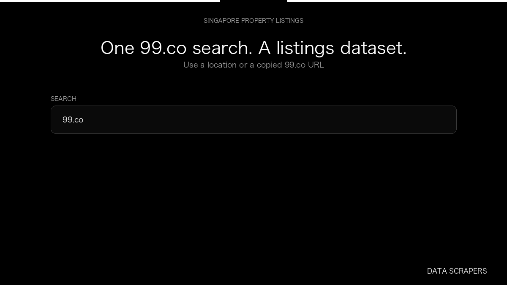

# 99.co Singapore Scraper

**99.co Singapore Scraper** is an Apify Actor by Data Scrapers for 99.co data.

This folder hosts the public demo GIF used on the Actor README. The scraper itself runs on Apify Store — not in this repository.

**[99.co Singapore Scraper on Apify](https://apify.com/datascrapers/99-co-scraper)**

## What this 99.co scraper does

Collect Singapore sale and rent listings from 99.co, including price, floor area, neighbourhood, and listing id.

Use it as a 99.co scraper to extract structured data and export CSV, JSON, Excel, or XML from Apify.

## Start here

1. Open [99.co Singapore Scraper](https://apify.com/datascrapers/99-co-scraper) on Apify Store.
2. Paste your 99.co URLs, queries, or other documented inputs.
3. Click **Start** and export JSON, CSV, Excel, or XML.

If you found this GitHub page while looking for a 99.co scraper, use the Apify link above to run it.
