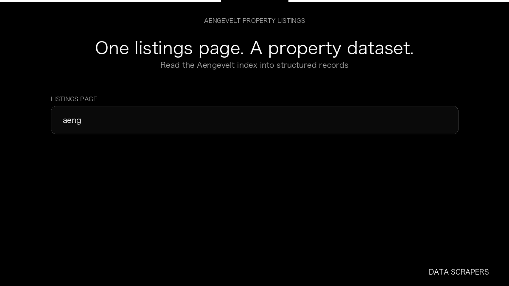

# Aengevelt Scraper

**Aengevelt Scraper** is an Apify Actor by Data Scrapers for Aengevelt data.

This folder hosts the public demo GIF used on the Actor README. The scraper itself runs on Apify Store — not in this repository.

**[Aengevelt Scraper on Apify](https://apify.com/datascrapers/aengevelt-scraper)**

## What this Aengevelt scraper does

Collect Aengevelt property listings with city, price, type code, and property id.

Use it as a Aengevelt scraper to extract structured data and export CSV, JSON, Excel, or XML from Apify.

## Start here

1. Open [Aengevelt Scraper](https://apify.com/datascrapers/aengevelt-scraper) on Apify Store.
2. Paste your Aengevelt URLs, queries, or other documented inputs.
3. Click **Start** and export JSON, CSV, Excel, or XML.

If you found this GitHub page while looking for a Aengevelt scraper, use the Apify link above to run it.
