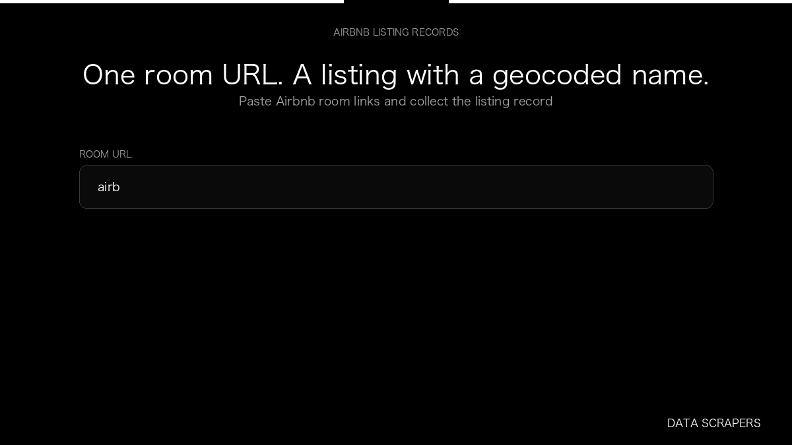

# Airbnb Address Finder

**Airbnb Address Finder** is an Apify Actor by Data Scrapers for Airbnb data.

This folder hosts the public demo GIF used on the Actor README. The scraper itself runs on Apify Store — not in this repository.

**[Airbnb Address Finder on Apify](https://apify.com/datascrapers/airbnb-address-finder)**

## What this Airbnb scraper does

Turn Airbnb room URLs into listing records with coordinates and a geocoded place name.

Use it as a Airbnb scraper to extract structured data and export CSV, JSON, Excel, or XML from Apify.

## Start here

1. Open [Airbnb Address Finder](https://apify.com/datascrapers/airbnb-address-finder) on Apify Store.
2. Paste your Airbnb URLs, queries, or other documented inputs.
3. Click **Start** and export JSON, CSV, Excel, or XML.

If you found this GitHub page while looking for a Airbnb scraper, use the Apify link above to run it.
