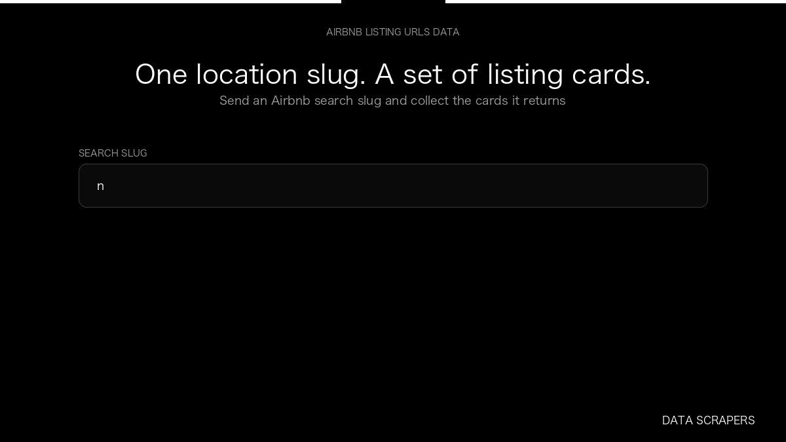

# Airbnb Listing URLs

**Airbnb Listing URLs** is an Apify Actor by Data Scrapers for Airbnb data.

This folder hosts the public demo GIF used on the Actor README. The scraper itself runs on Apify Store — not in this repository.

**[Airbnb Listing URLs on Apify](https://apify.com/datascrapers/airbnb-listing-urls)**

## What this Airbnb scraper does

Collects Airbnb search-result listing cards, including the room URL, rating, review count, and coordinates.

Use it as a Airbnb scraper to extract structured data and export CSV, JSON, Excel, or XML from Apify.

## Start here

1. Open [Airbnb Listing URLs](https://apify.com/datascrapers/airbnb-listing-urls) on Apify Store.
2. Paste your Airbnb URLs, queries, or other documented inputs.
3. Click **Start** and export JSON, CSV, Excel, or XML.

If you found this GitHub page while looking for a Airbnb scraper, use the Apify link above to run it.
