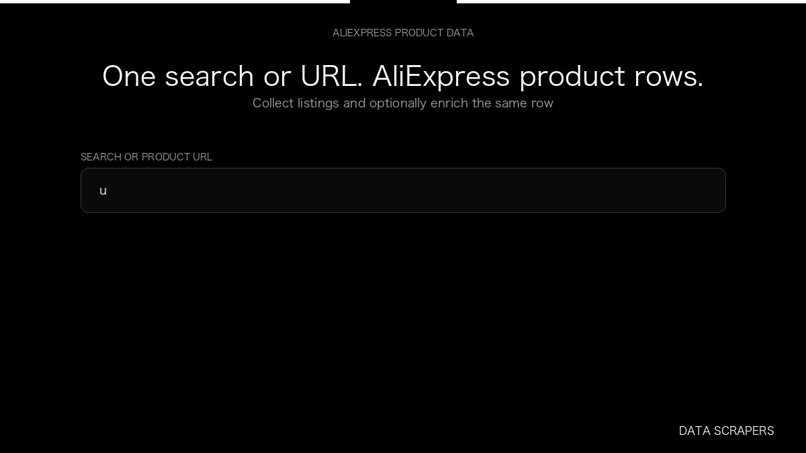

# AliExpress Scraper

**AliExpress Scraper** is an Apify Actor by Data Scrapers for AliExpress data.

This folder hosts the public demo GIF used on the Actor README. The scraper itself runs on Apify Store — not in this repository.

**[AliExpress Scraper on Apify](https://apify.com/datascrapers/aliexpress-scraper)**

## What this AliExpress scraper does

Search AliExpress by query or product URL and collect structured product rows with price, rating, sold, and images. Optionally add productDetails and productReviews on the same row.

Use it as a AliExpress scraper to extract structured data and export CSV, JSON, Excel, or XML from Apify.

## Start here

1. Open [AliExpress Scraper](https://apify.com/datascrapers/aliexpress-scraper) on Apify Store.
2. Paste your AliExpress URLs, queries, or other documented inputs.
3. Click **Start** and export JSON, CSV, Excel, or XML.

If you found this GitHub page while looking for a AliExpress scraper, use the Apify link above to run it.
