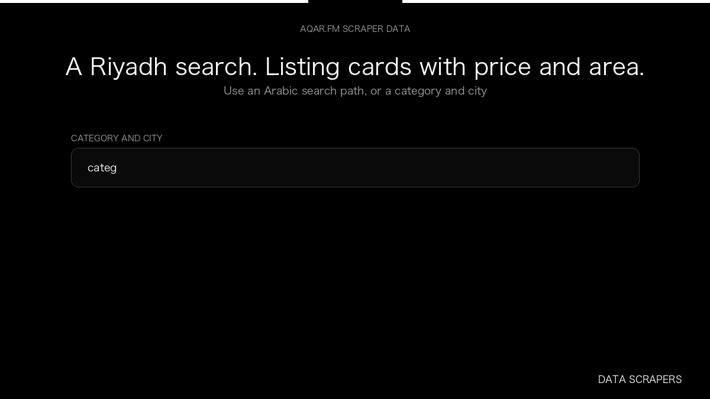

# Aqar.fm Scraper

**Aqar.fm Scraper** is an Apify Actor by Data Scrapers for Aqar.fm data.

This folder hosts the public demo GIF used on the Actor README. The scraper itself runs on Apify Store — not in this repository.

**[Aqar.fm Scraper on Apify](https://apify.com/datascrapers/aqar-fm-scraper)**

## What this Aqar.fm scraper does

Collects Saudi property listings from aqar.fm, including price, area, city, and the listing URL.

Use it as a Aqar.fm scraper to extract structured data and export CSV, JSON, Excel, or XML from Apify.

## Start here

1. Open [Aqar.fm Scraper](https://apify.com/datascrapers/aqar-fm-scraper) on Apify Store.
2. Paste your Aqar.fm URLs, queries, or other documented inputs.
3. Click **Start** and export JSON, CSV, Excel, or XML.

If you found this GitHub page while looking for a Aqar.fm scraper, use the Apify link above to run it.
