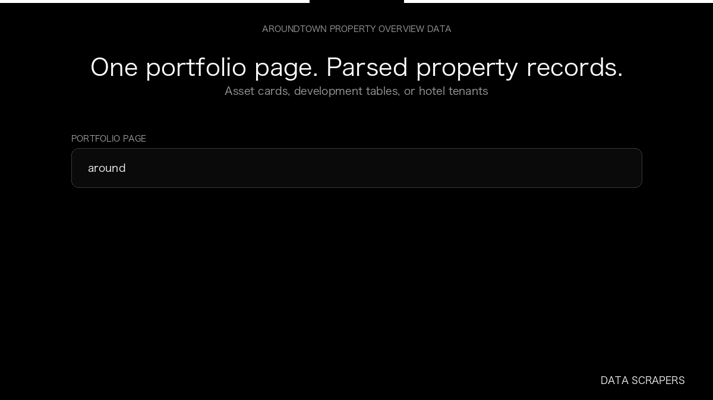

# AroundTown Property Overview

**AroundTown Property Overview** is an Apify Actor by Data Scrapers for Aroundtown data.

This folder hosts the public demo GIF used on the Actor README. The scraper itself runs on Apify Store — not in this repository.

**[AroundTown Property Overview on Apify](https://apify.com/datascrapers/aroundtown)**

## What this Aroundtown scraper does

Parses Aroundtown portfolio pages into asset cards, development project rows, and hotel tenant records.

Use it as a Aroundtown scraper to extract structured data and export CSV, JSON, Excel, or XML from Apify.

## Start here

1. Open [AroundTown Property Overview](https://apify.com/datascrapers/aroundtown) on Apify Store.
2. Paste your Aroundtown URLs, queries, or other documented inputs.
3. Click **Start** and export JSON, CSV, Excel, or XML.

If you found this GitHub page while looking for a Aroundtown scraper, use the Apify link above to run it.
