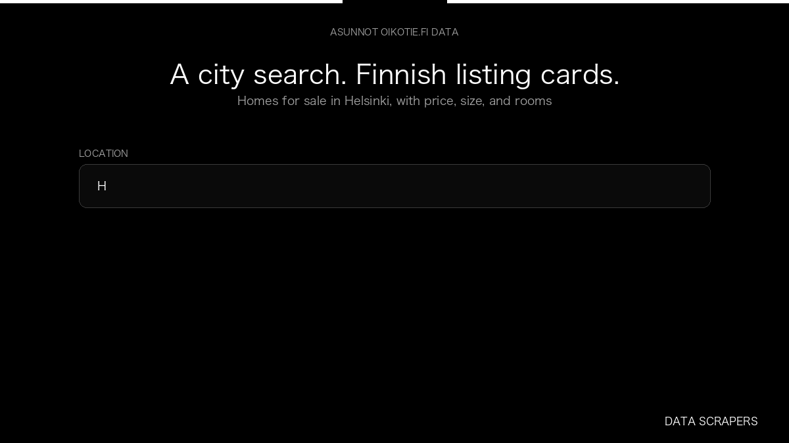

# Asunnot Oikotie.fi Real Estate Scraper

**Asunnot Oikotie.fi Real Estate Scraper** is an Apify Actor by Data Scrapers for Oikotie Asunnot data.

This folder hosts the public demo GIF used on the Actor README. The scraper itself runs on Apify Store — not in this repository.

**[Asunnot Oikotie.fi Real Estate Scraper on Apify](https://apify.com/datascrapers/asunnot-oikotie-fi)**

## What this Oikotie Asunnot scraper does

Collects Finnish property listings from asunnot.oikotie.fi, including price, living area, rooms, and address.

Use it as a Oikotie Asunnot scraper to extract structured data and export CSV, JSON, Excel, or XML from Apify.

## Start here

1. Open [Asunnot Oikotie.fi Real Estate Scraper](https://apify.com/datascrapers/asunnot-oikotie-fi) on Apify Store.
2. Paste your Oikotie Asunnot URLs, queries, or other documented inputs.
3. Click **Start** and export JSON, CSV, Excel, or XML.

If you found this GitHub page while looking for a Oikotie Asunnot scraper, use the Apify link above to run it.
