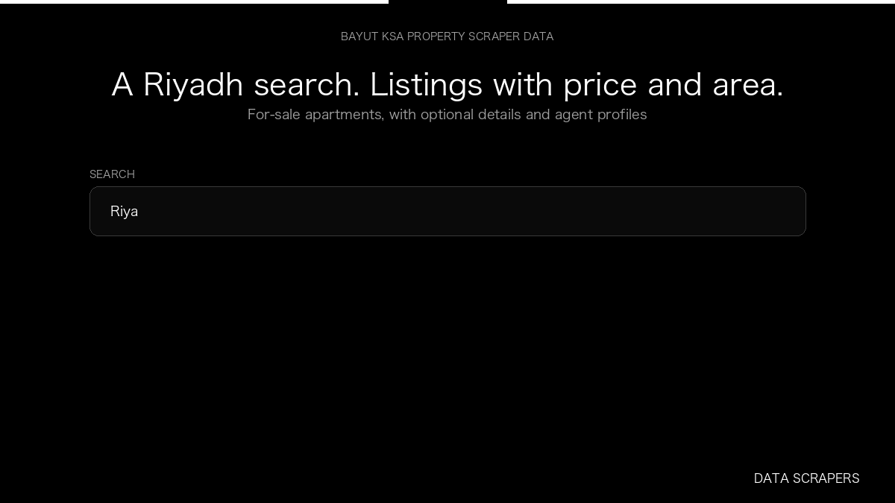

# Bayut KSA Property Scraper

**Bayut KSA Property Scraper** is an Apify Actor by Data Scrapers for Bayut data.

This folder hosts the public demo GIF used on the Actor README. The scraper itself runs on Apify Store — not in this repository.

**[Bayut KSA Property Scraper on Apify](https://apify.com/datascrapers/bayut-sa-scraper)**

## What this Bayut scraper does

Collects property listings from Bayut Saudi Arabia, including price, rooms, area, and the listing URL.

Use it as a Bayut scraper to extract structured data and export CSV, JSON, Excel, or XML from Apify.

## Start here

1. Open [Bayut KSA Property Scraper](https://apify.com/datascrapers/bayut-sa-scraper) on Apify Store.
2. Paste your Bayut URLs, queries, or other documented inputs.
3. Click **Start** and export JSON, CSV, Excel, or XML.

If you found this GitHub page while looking for a Bayut scraper, use the Apify link above to run it.
