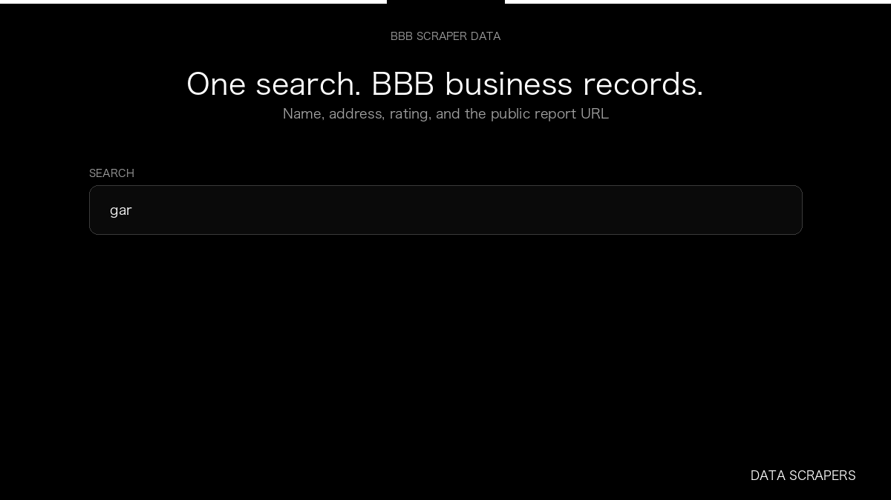

# BBB Scraper

**BBB Scraper** is an Apify Actor by Data Scrapers for Better Business Bureau data.

This folder hosts the public demo GIF used on the Actor README. The scraper itself runs on Apify Store — not in this repository.

**[BBB Scraper on Apify](https://apify.com/datascrapers/bbb-scraper)**

## What this Better Business Bureau scraper does

Collects Better Business Bureau search records, including name, address, rating, and the report URL.

Use it as a Better Business Bureau scraper to extract structured data and export CSV, JSON, Excel, or XML from Apify.

## Start here

1. Open [BBB Scraper](https://apify.com/datascrapers/bbb-scraper) on Apify Store.
2. Paste your Better Business Bureau URLs, queries, or other documented inputs.
3. Click **Start** and export JSON, CSV, Excel, or XML.

If you found this GitHub page while looking for a Better Business Bureau scraper, use the Apify link above to run it.
