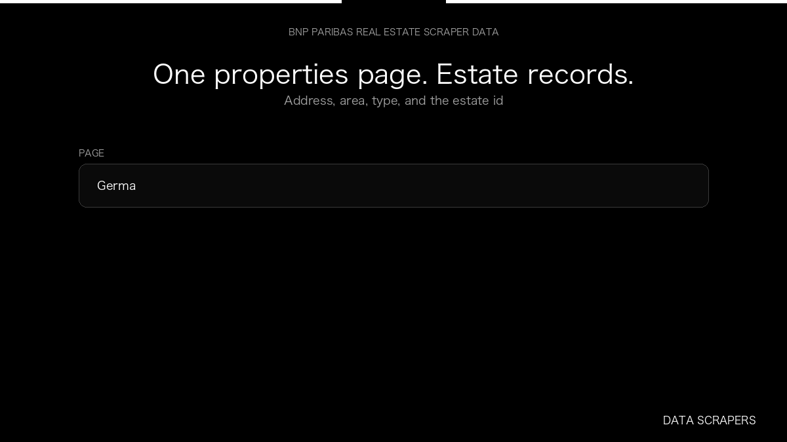

# BNP Paribas Real Estate Scraper

**BNP Paribas Real Estate Scraper** is an Apify Actor by Data Scrapers for BNP Paribas Real Estate data.

This folder hosts the public demo GIF used on the Actor README. The scraper itself runs on Apify Store — not in this repository.

**[BNP Paribas Real Estate Scraper on Apify](https://apify.com/datascrapers/bnppre-scraper)**

## What this BNP Paribas Real Estate scraper does

German commercial property listings with address and area.

Use it as a BNP Paribas Real Estate scraper to extract structured data and export CSV, JSON, Excel, or XML from Apify.

## Start here

1. Open [BNP Paribas Real Estate Scraper](https://apify.com/datascrapers/bnppre-scraper) on Apify Store.
2. Paste your BNP Paribas Real Estate URLs, queries, or other documented inputs.
3. Click **Start** and export JSON, CSV, Excel, or XML.

If you found this GitHub page while looking for a BNP Paribas Real Estate scraper, use the Apify link above to run it.
