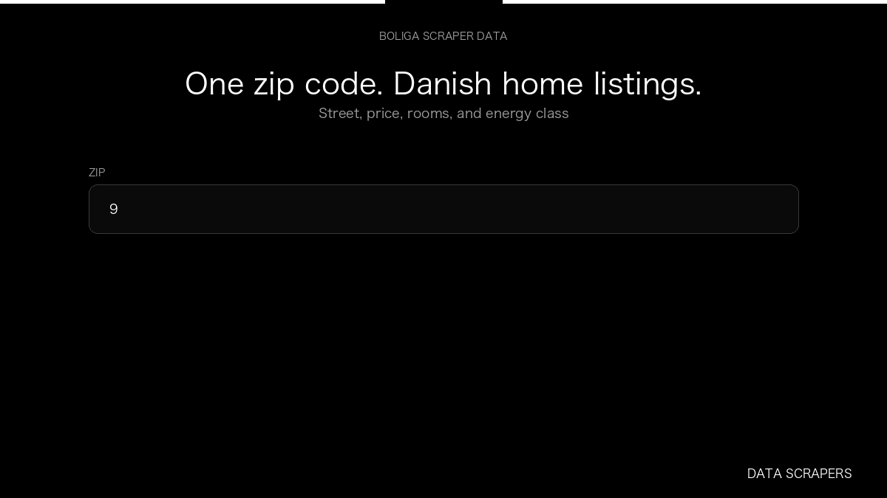

# Boliga Scraper

**Boliga Scraper** is an Apify Actor by Data Scrapers for Boliga data.

This folder hosts the public demo GIF used on the Actor README. The scraper itself runs on Apify Store — not in this repository.

**[Boliga Scraper on Apify](https://apify.com/datascrapers/boliga-dk-scraper)**

## What this Boliga scraper does

Danish home listings with price, rooms, and energy class.

Use it as a Boliga scraper to extract structured data and export CSV, JSON, Excel, or XML from Apify.

## Start here

1. Open [Boliga Scraper](https://apify.com/datascrapers/boliga-dk-scraper) on Apify Store.
2. Paste your Boliga URLs, queries, or other documented inputs.
3. Click **Start** and export JSON, CSV, Excel, or XML.

If you found this GitHub page while looking for a Boliga scraper, use the Apify link above to run it.
