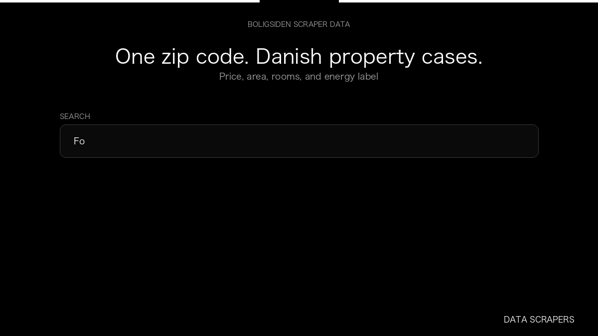

# Boligsiden Scraper

**Boligsiden Scraper** is an Apify Actor by Data Scrapers for Boligsiden data.

This folder hosts the public demo GIF used on the Actor README. The scraper itself runs on Apify Store — not in this repository.

**[Boligsiden Scraper on Apify](https://apify.com/datascrapers/boligsiden-dk-scraper)**

## What this Boligsiden scraper does

Danish property cases with cash price, area, and rooms.

Use it as a Boligsiden scraper to extract structured data and export CSV, JSON, Excel, or XML from Apify.

## Start here

1. Open [Boligsiden Scraper](https://apify.com/datascrapers/boligsiden-dk-scraper) on Apify Store.
2. Paste your Boligsiden URLs, queries, or other documented inputs.
3. Click **Start** and export JSON, CSV, Excel, or XML.

If you found this GitHub page while looking for a Boligsiden scraper, use the Apify link above to run it.
