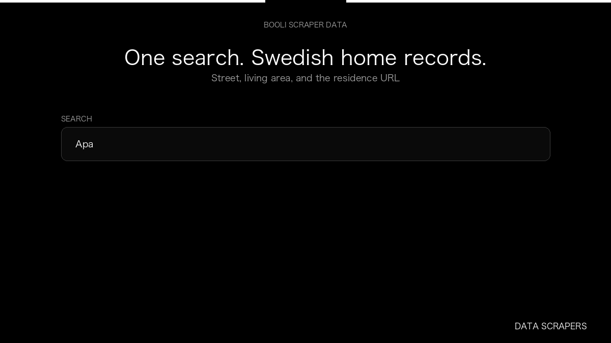

# Booli Scraper

**Booli Scraper** is an Apify Actor by Data Scrapers for Booli data.

This folder hosts the public demo GIF used on the Actor README. The scraper itself runs on Apify Store — not in this repository.

**[Booli Scraper on Apify](https://apify.com/datascrapers/booli-se-scraper)**

## What this Booli scraper does

Swedish home listings with street address and living area.

Use it as a Booli scraper to extract structured data and export CSV, JSON, Excel, or XML from Apify.

## Start here

1. Open [Booli Scraper](https://apify.com/datascrapers/booli-se-scraper) on Apify Store.
2. Paste your Booli URLs, queries, or other documented inputs.
3. Click **Start** and export JSON, CSV, Excel, or XML.

If you found this GitHub page while looking for a Booli scraper, use the Apify link above to run it.
