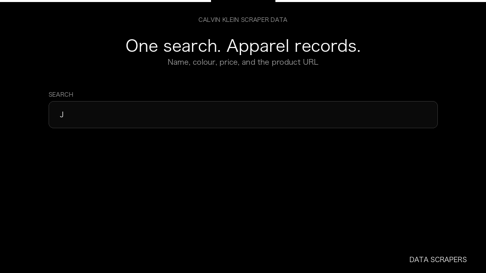

# Calvin Klein Scraper

**Calvin Klein Scraper** is an Apify Actor by Data Scrapers for Calvin Klein data.

This folder hosts the public demo GIF used on the Actor README. The scraper itself runs on Apify Store — not in this repository.

**[Calvin Klein Scraper on Apify](https://apify.com/datascrapers/calvinklein-scraper)**

## What this Calvin Klein scraper does

Apparel colorways with price, colour, and product URL.

Use it as a Calvin Klein scraper to extract structured data and export CSV, JSON, Excel, or XML from Apify.

## Start here

1. Open [Calvin Klein Scraper](https://apify.com/datascrapers/calvinklein-scraper) on Apify Store.
2. Paste your Calvin Klein URLs, queries, or other documented inputs.
3. Click **Start** and export JSON, CSV, Excel, or XML.

If you found this GitHub page while looking for a Calvin Klein scraper, use the Apify link above to run it.
