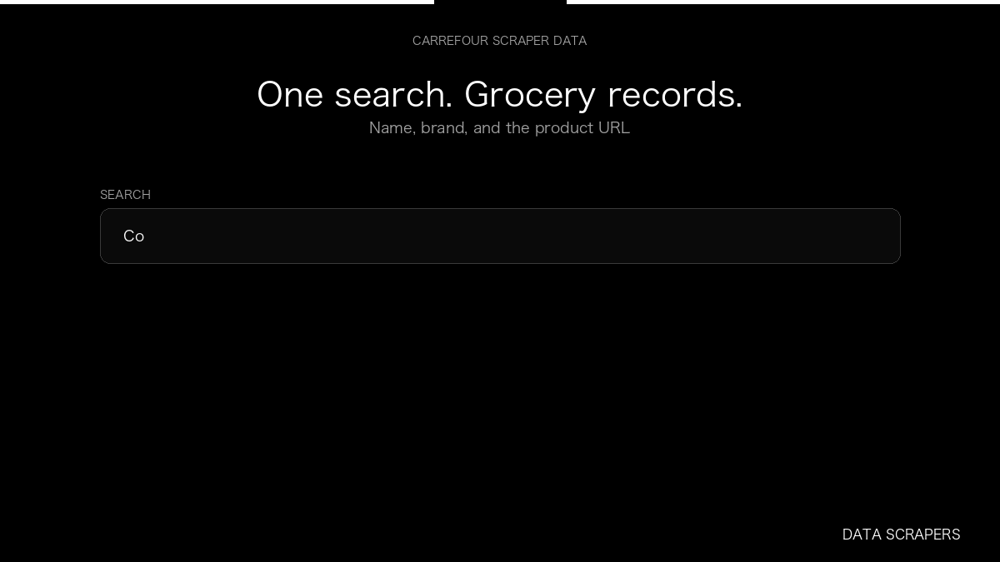

# Carrefour Scraper

**Carrefour Scraper** is an Apify Actor by Data Scrapers for Carrefour data.

This folder hosts the public demo GIF used on the Actor README. The scraper itself runs on Apify Store — not in this repository.

**[Carrefour Scraper on Apify](https://apify.com/datascrapers/carrefour-scraper)**

## What this Carrefour scraper does

Grocery products with brand, currency, and product URL.

Use it as a Carrefour scraper to extract structured data and export CSV, JSON, Excel, or XML from Apify.

## Start here

1. Open [Carrefour Scraper](https://apify.com/datascrapers/carrefour-scraper) on Apify Store.
2. Paste your Carrefour URLs, queries, or other documented inputs.
3. Click **Start** and export JSON, CSV, Excel, or XML.

If you found this GitHub page while looking for a Carrefour scraper, use the Apify link above to run it.
