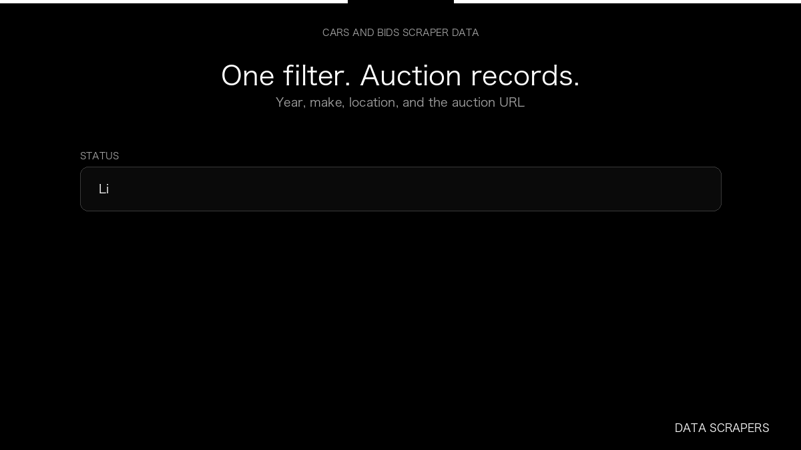

# Cars and Bids Scraper

**Cars and Bids Scraper** is an Apify Actor by Data Scrapers for Cars and Bids data.

This folder hosts the public demo GIF used on the Actor README. The scraper itself runs on Apify Store — not in this repository.

**[Cars and Bids Scraper on Apify](https://apify.com/datascrapers/carsandbids-scraper)**

## What this Cars and Bids scraper does

Car auctions with year, make, location, and auction URL.

Use it as a Cars and Bids scraper to extract structured data and export CSV, JSON, Excel, or XML from Apify.

## Start here

1. Open [Cars and Bids Scraper](https://apify.com/datascrapers/carsandbids-scraper) on Apify Store.
2. Paste your Cars and Bids URLs, queries, or other documented inputs.
3. Click **Start** and export JSON, CSV, Excel, or XML.

If you found this GitHub page while looking for a Cars and Bids scraper, use the Apify link above to run it.
