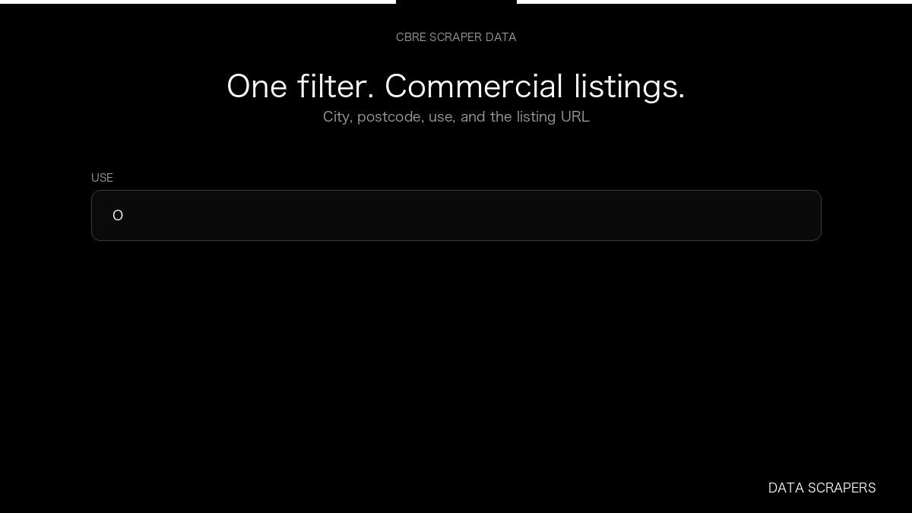

# CBRE Scraper

**CBRE Scraper** is an Apify Actor by Data Scrapers for CBRE data.

This folder hosts the public demo GIF used on the Actor README. The scraper itself runs on Apify Store — not in this repository.

**[CBRE Scraper on Apify](https://apify.com/datascrapers/cbre-scraper)**

## What this CBRE scraper does

German commercial listings with city, use, and listing URL.

Use it as a CBRE scraper to extract structured data and export CSV, JSON, Excel, or XML from Apify.

## Start here

1. Open [CBRE Scraper](https://apify.com/datascrapers/cbre-scraper) on Apify Store.
2. Paste your CBRE URLs, queries, or other documented inputs.
3. Click **Start** and export JSON, CSV, Excel, or XML.

If you found this GitHub page while looking for a CBRE scraper, use the Apify link above to run it.
