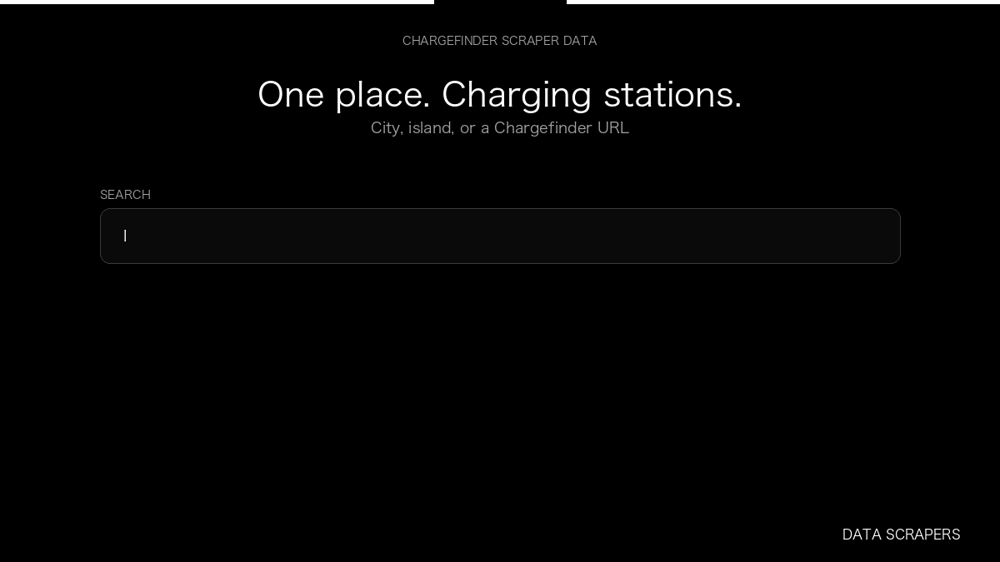

# Chargefinder Scraper

**Chargefinder Scraper** is an Apify Actor by Data Scrapers for Chargefinder data.

This folder hosts the public demo GIF used on the Actor README. The scraper itself runs on Apify Store — not in this repository.

**[Chargefinder Scraper on Apify](https://apify.com/datascrapers/chargefinder-scraper)**

## What this Chargefinder scraper does

Chargefinder charging stations with operator, power, and station id.

Use it as a Chargefinder scraper to extract structured data and export CSV, JSON, Excel, or XML from Apify.

## Start here

1. Open [Chargefinder Scraper](https://apify.com/datascrapers/chargefinder-scraper) on Apify Store.
2. Paste your Chargefinder URLs, queries, or other documented inputs.
3. Click **Start** and export JSON, CSV, Excel, or XML.

If you found this GitHub page while looking for a Chargefinder scraper, use the Apify link above to run it.
