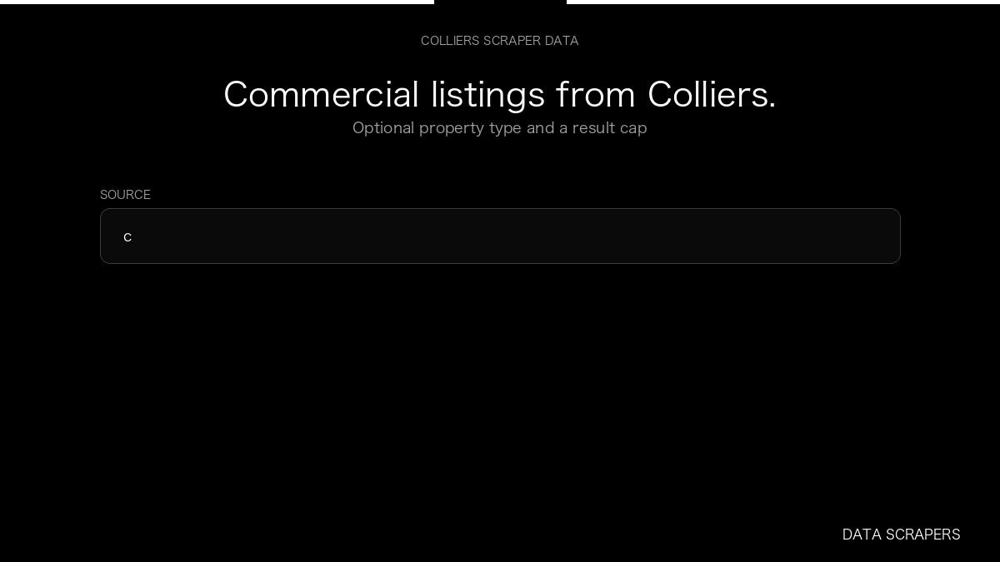

# Colliers Scraper

**Colliers Scraper** is an Apify Actor by Data Scrapers for Colliers data.

This folder hosts the public demo GIF used on the Actor README. The scraper itself runs on Apify Store — not in this repository.

**[Colliers Scraper on Apify](https://apify.com/datascrapers/colliers-scraper)**

## What this Colliers scraper does

Colliers Germany commercial listings with area, rent, and listing id.

Use it as a Colliers scraper to extract structured data and export CSV, JSON, Excel, or XML from Apify.

## Start here

1. Open [Colliers Scraper](https://apify.com/datascrapers/colliers-scraper) on Apify Store.
2. Paste your Colliers URLs, queries, or other documented inputs.
3. Click **Start** and export JSON, CSV, Excel, or XML.

If you found this GitHub page while looking for a Colliers scraper, use the Apify link above to run it.
