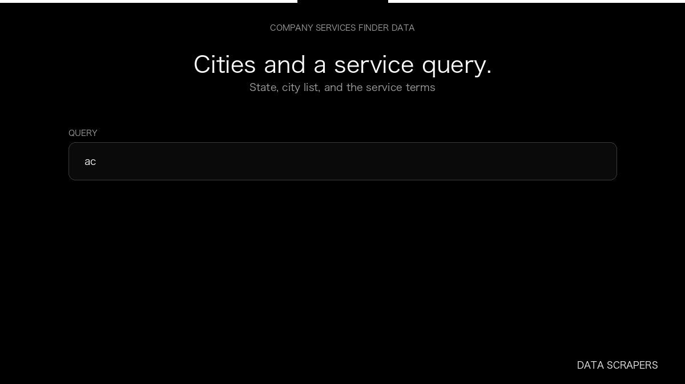

# Company Services Finder

**Company Services Finder** is an Apify Actor by Data Scrapers for Company websites data.

This folder hosts the public demo GIF used on the Actor README. The scraper itself runs on Apify Store — not in this repository.

**[Company Services Finder on Apify](https://apify.com/datascrapers/company-service-finder)**

## What this Company websites scraper does

Company websites and the service labels listed on those sites.

Use it as a Company websites scraper to extract structured data and export CSV, JSON, Excel, or XML from Apify.

## Start here

1. Open [Company Services Finder](https://apify.com/datascrapers/company-service-finder) on Apify Store.
2. Paste your Company websites URLs, queries, or other documented inputs.
3. Click **Start** and export JSON, CSV, Excel, or XML.

If you found this GitHub page while looking for a Company websites scraper, use the Apify link above to run it.
