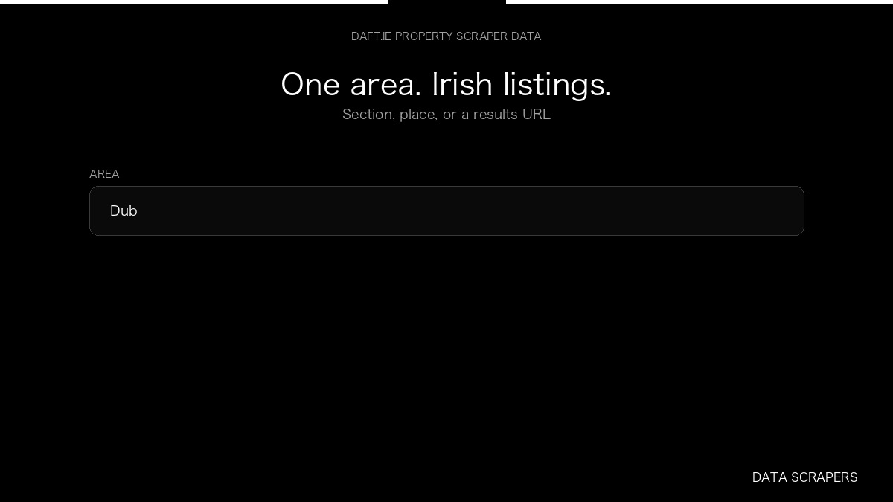

# Daft.ie Property Scraper

**Daft.ie Property Scraper** is an Apify Actor by Data Scrapers for Daft.ie data.

This folder hosts the public demo GIF used on the Actor README. The scraper itself runs on Apify Store — not in this repository.

**[Daft.ie Property Scraper on Apify](https://apify.com/datascrapers/daft-ie-scraper)**

## What this Daft.ie scraper does

Daft.ie property listings with price, type, and listing id.

Use it as a Daft.ie scraper to extract structured data and export CSV, JSON, Excel, or XML from Apify.

## Start here

1. Open [Daft.ie Property Scraper](https://apify.com/datascrapers/daft-ie-scraper) on Apify Store.
2. Paste your Daft.ie URLs, queries, or other documented inputs.
3. Click **Start** and export JSON, CSV, Excel, or XML.

If you found this GitHub page while looking for a Daft.ie scraper, use the Apify link above to run it.
