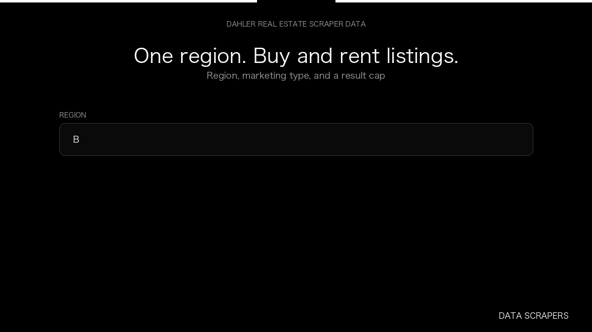

# DAHLER Real Estate Scraper

**DAHLER Real Estate Scraper** is an Apify Actor by Data Scrapers for DAHLER data.

This folder hosts the public demo GIF used on the Actor README. The scraper itself runs on Apify Store — not in this repository.

**[DAHLER Real Estate Scraper on Apify](https://apify.com/datascrapers/dahler-scraper)**

## What this DAHLER scraper does

DAHLER buy and rent listings with price, area, and property id.

Use it as a DAHLER scraper to extract structured data and export CSV, JSON, Excel, or XML from Apify.

## Start here

1. Open [DAHLER Real Estate Scraper](https://apify.com/datascrapers/dahler-scraper) on Apify Store.
2. Paste your DAHLER URLs, queries, or other documented inputs.
3. Click **Start** and export JSON, CSV, Excel, or XML.

If you found this GitHub page while looking for a DAHLER scraper, use the Apify link above to run it.
