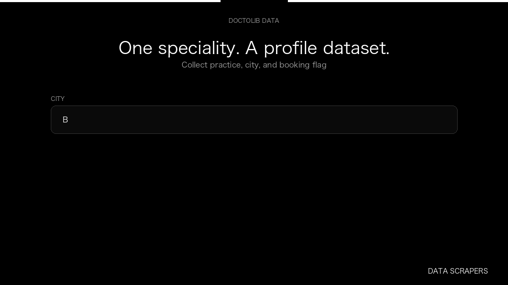

# Doctolib Doctor Scraper

**Doctolib Doctor Scraper** is an Apify Actor by Data Scrapers for Doctolib data.

This folder hosts the public demo GIF used on the Actor README. The scraper itself runs on Apify Store — not in this repository.

**[Doctolib Doctor Scraper on Apify](https://apify.com/datascrapers/doctorlib-scraper)**

## What this Doctolib scraper does

Collect Doctolib profiles as a dataset, with speciality, city, and booking flag.

Use it as a Doctolib scraper to extract structured data and export CSV, JSON, Excel, or XML from Apify.

## Start here

1. Open [Doctolib Doctor Scraper](https://apify.com/datascrapers/doctorlib-scraper) on Apify Store.
2. Paste your Doctolib URLs, queries, or other documented inputs.
3. Click **Start** and export JSON, CSV, Excel, or XML.

If you found this GitHub page while looking for a Doctolib scraper, use the Apify link above to run it.
