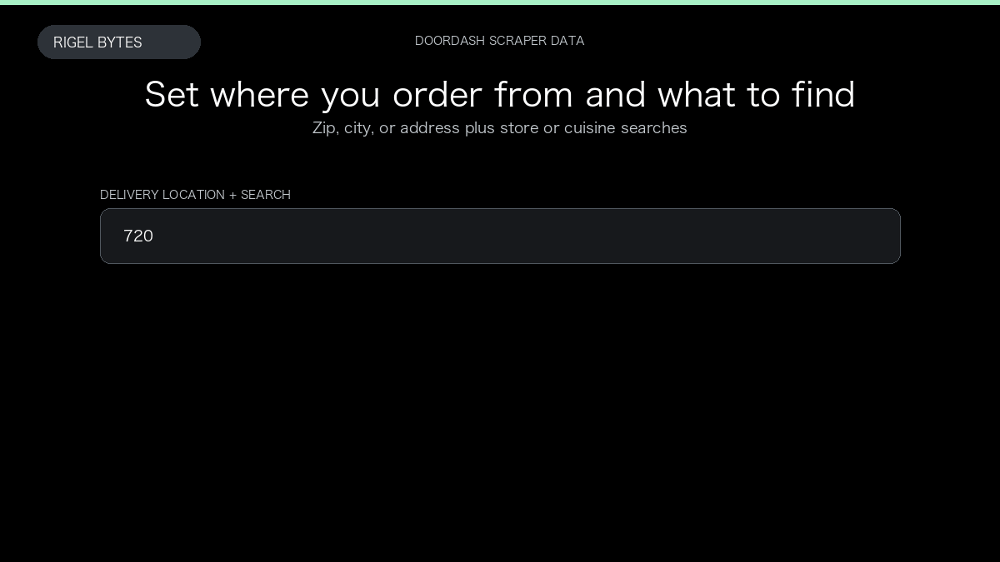

# DoorDash Scraper

**DoorDash Scraper** is an Apify Actor by Rigel Bytes for DoorDash data.

This folder hosts the public demo GIF used on the Actor README. The scraper itself runs on Apify Store — not in this repository.

**[DoorDash Scraper on Apify](https://apify.com/rigelbytes/doordash-scraper)**

## What this DoorDash scraper does

Scrape DoorDash menus, grocery items, stores, and collections for a delivery location — export structured JSON for price and menu research.

Use it as a DoorDash scraper to extract structured data and export CSV, JSON, Excel, or XML from Apify.

## Start here

1. Open [DoorDash Scraper](https://apify.com/rigelbytes/doordash-scraper) on Apify Store.
2. Paste your DoorDash URLs, queries, or other documented inputs.
3. Click **Start** and export JSON, CSV, Excel, or XML.

If you found this GitHub page while looking for a DoorDash scraper, use the Apify link above to run it.
