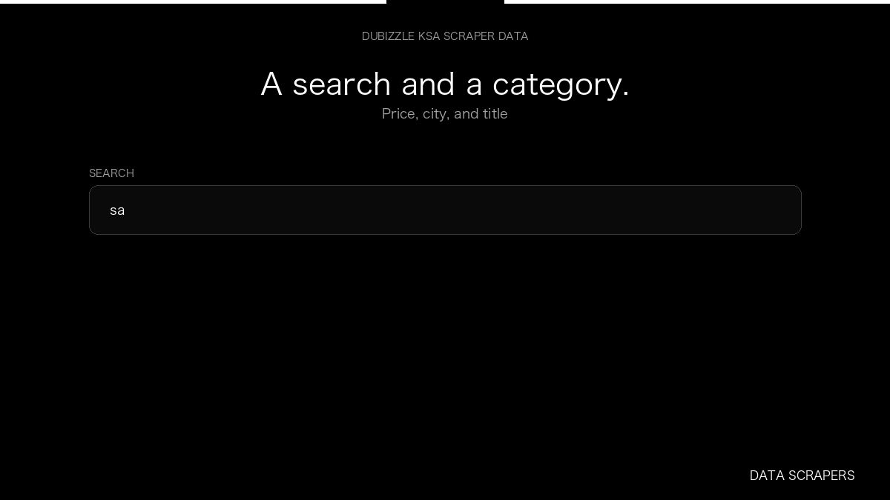

# Dubizzle KSA Scraper

**Dubizzle KSA Scraper** is an Apify Actor by Data Scrapers for Dubizzle data.

This folder hosts the public demo GIF used on the Actor README. The scraper itself runs on Apify Store — not in this repository.

**[Dubizzle KSA Scraper on Apify](https://apify.com/datascrapers/dubizzle-ksa-scraper)**

## What this Dubizzle scraper does

Dubizzle Saudi Arabia listings with title, city, price, and currency.

Use it as a Dubizzle scraper to extract structured data and export CSV, JSON, Excel, or XML from Apify.

## Start here

1. Open [Dubizzle KSA Scraper](https://apify.com/datascrapers/dubizzle-ksa-scraper) on Apify Store.
2. Paste your Dubizzle URLs, queries, or other documented inputs.
3. Click **Start** and export JSON, CSV, Excel, or XML.

If you found this GitHub page while looking for a Dubizzle scraper, use the Apify link above to run it.
