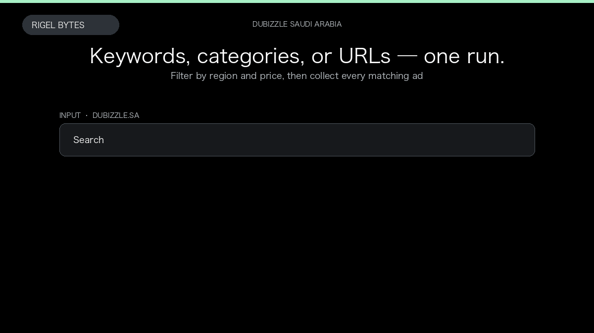

# Dubizzle KSA Scraper

**Dubizzle KSA Scraper** is an Apify Actor by Rigel Bytes for Dubizzle Saudi Arabia data.

This folder hosts the public demo GIF used on the Actor README. The scraper itself runs on Apify Store — not in this repository.

**[Dubizzle KSA Scraper on Apify](https://apify.com/rigelbytes/dubizzle-ksa-scraper)**

## What this Dubizzle Saudi Arabia scraper does

Extract classified ads from dubizzle.sa — vehicles, property, jobs, and electronics with SAR prices, photos, and seller data. Export JSON or CSV from SKILL_DIR="/Users/a/.cursor/skills/create-apify-readme-gif"; [ -d "$SKILL_DIR" ] || SKILL_DIR="/Users/a/Desktop/Work/skills/create-apify-readme-gif"; python3 "$SKILL_DIR/scripts/publish_actor_asset.py" --gif /Users/a/Desktop/Work/Apify/dubizzle-ksa-scraper/dubizzle-ksa-scraper-value-demo.gif --actor-slug dubizzle-ksa-scraper --actor-name "Dubizzle KSA Scraper" --actor-url "https://apify.com/rigelbytes/dubizzle-ksa-scraper" --description "Extract classified ads from dubizzle.sa — vehicles, property, jobs, and electronics with SAR prices, photos, and seller data. Export JSON or CSV from $1 per 1,000 listings." --platform "Dubizzle Saudi Arabia" --brand "Rigel Bytes" 2>&1 per 1,000 listings.

Use it as a Dubizzle Saudi Arabia scraper to extract structured data and export CSV, JSON, Excel, or XML from Apify.

## Start here

1. Open [Dubizzle KSA Scraper](https://apify.com/rigelbytes/dubizzle-ksa-scraper) on Apify Store.
2. Paste your Dubizzle Saudi Arabia URLs, queries, or other documented inputs.
3. Click **Start** and export JSON, CSV, Excel, or XML.

If you found this GitHub page while looking for a Dubizzle Saudi Arabia scraper, use the Apify link above to run it.
