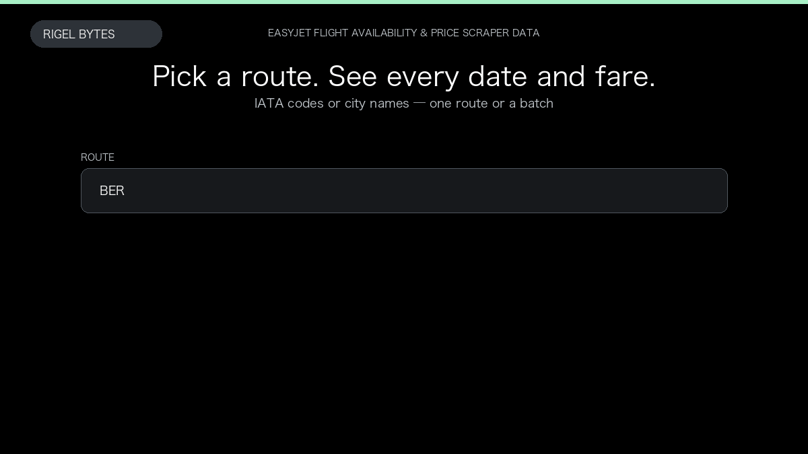

# easyJet Flight Availability & Price Scraper

**easyJet Flight Availability & Price Scraper** is an Apify Actor by Rigel Bytes for easyJet data.

This folder hosts the public demo GIF used on the Actor README. The scraper itself runs on Apify Store — not in this repository.

**[easyJet Flight Availability & Price Scraper on Apify](https://apify.com/rigelbytes/easyJet-scraper)**

## What this easyJet scraper does

Scrape easyJet calendar availability and lowest fares by route. Export dated prices, low-fare flags, and booking deeplinks for research and monitoring.

Use it as a easyJet scraper to extract structured data and export CSV, JSON, Excel, or XML from Apify.

## Start here

1. Open [easyJet Flight Availability & Price Scraper](https://apify.com/rigelbytes/easyJet-scraper) on Apify Store.
2. Paste your easyJet URLs, queries, or other documented inputs.
3. Click **Start** and export JSON, CSV, Excel, or XML.

If you found this GitHub page while looking for a easyJet scraper, use the Apify link above to run it.
