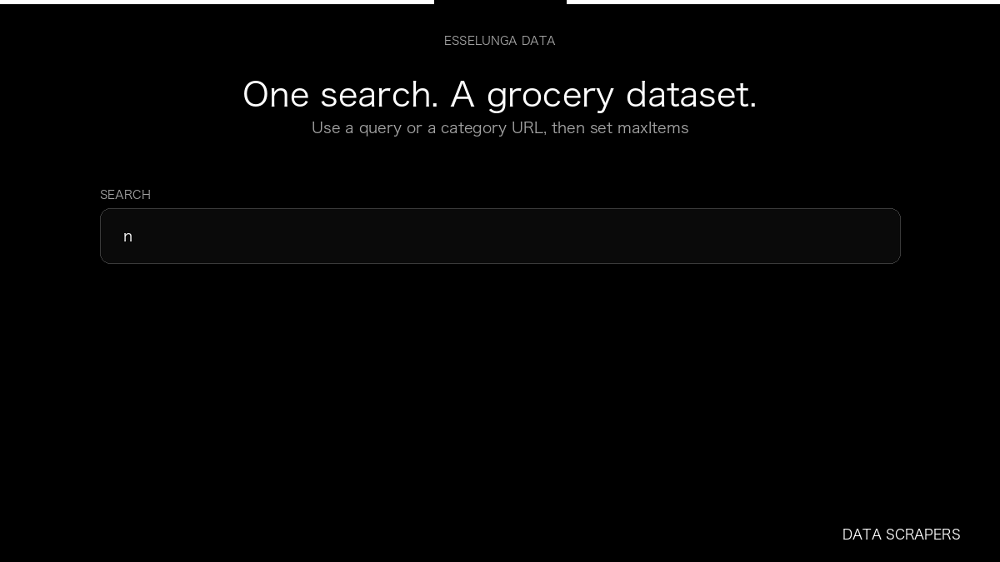

# Esselunga Scraper

**Esselunga Scraper** is an Apify Actor by Data Scrapers for Esselunga data.

This folder hosts the public demo GIF used on the Actor README. The scraper itself runs on Apify Store — not in this repository.

**[Esselunga Scraper on Apify](https://apify.com/datascrapers/esselunga-scraper)**

## What this Esselunga scraper does

Collect Esselunga grocery products as a dataset, with price, brand, and product code.

Use it as a Esselunga scraper to extract structured data and export CSV, JSON, Excel, or XML from Apify.

## Start here

1. Open [Esselunga Scraper](https://apify.com/datascrapers/esselunga-scraper) on Apify Store.
2. Paste your Esselunga URLs, queries, or other documented inputs.
3. Click **Start** and export JSON, CSV, Excel, or XML.

If you found this GitHub page while looking for a Esselunga scraper, use the Apify link above to run it.
