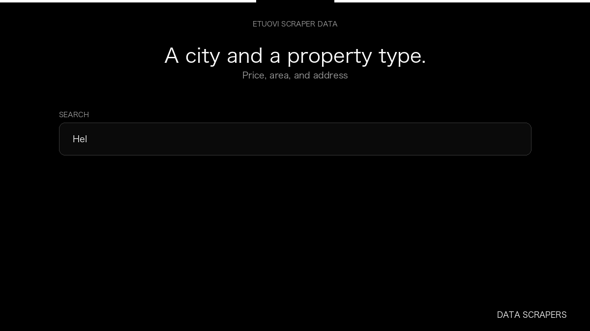

# Etuovi Scraper

**Etuovi Scraper** is an Apify Actor by Data Scrapers for Etuovi data.

This folder hosts the public demo GIF used on the Actor README. The scraper itself runs on Apify Store — not in this repository.

**[Etuovi Scraper on Apify](https://apify.com/datascrapers/etuovi-scraper)**

## What this Etuovi scraper does

Etuovi listings with address, city, asking price, and living area.

Use it as a Etuovi scraper to extract structured data and export CSV, JSON, Excel, or XML from Apify.

## Start here

1. Open [Etuovi Scraper](https://apify.com/datascrapers/etuovi-scraper) on Apify Store.
2. Paste your Etuovi URLs, queries, or other documented inputs.
3. Click **Start** and export JSON, CSV, Excel, or XML.

If you found this GitHub page while looking for a Etuovi scraper, use the Apify link above to run it.
