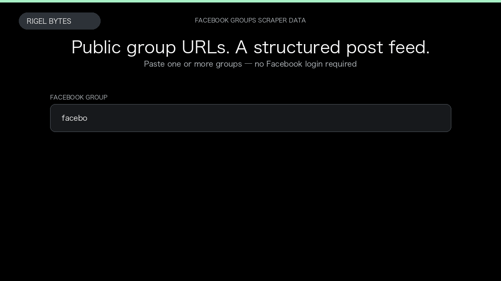

# Facebook Groups Scraper

**Facebook Groups Scraper** is an Apify Actor by Rigel Bytes for Facebook Groups data.

This folder hosts the public demo GIF used on the Actor README. The scraper itself runs on Apify Store — not in this repository.

**[Facebook Groups Scraper on Apify](https://apify.com/rigelbytes/facebook-groups-scraper)**

## What this Facebook Groups scraper does

Scrape public posts from Facebook groups without logging in. Get post text, authors, dates, engagement counts, media links, and group metadata in a structured dataset.

Use it as a Facebook Groups scraper to extract structured data and export CSV, JSON, Excel, or XML from Apify.

## Start here

1. Open [Facebook Groups Scraper](https://apify.com/rigelbytes/facebook-groups-scraper) on Apify Store.
2. Paste your Facebook Groups URLs, queries, or other documented inputs.
3. Click **Start** and export JSON, CSV, Excel, or XML.

If you found this GitHub page while looking for a Facebook Groups scraper, use the Apify link above to run it.
