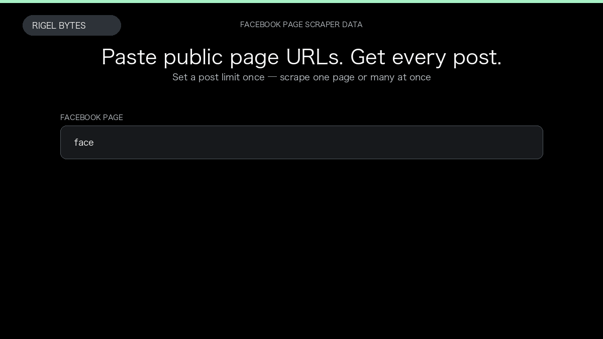

# Facebook Page Scraper

**Facebook Page Scraper** is an Apify Actor by Rigel Bytes for Facebook data.

This folder hosts the public demo GIF used on the Actor README. The scraper itself runs on Apify Store — not in this repository.

**[Facebook Page Scraper on Apify](https://apify.com/rigelbytes/facebook-page-scraper)**

## What this Facebook scraper does

Scrape public Facebook page posts with text, media links, dates, and engagement metrics. Optionally collect people who reacted to each post with reaction types.

Use it as a Facebook scraper to extract structured data and export CSV, JSON, Excel, or XML from Apify.

## Start here

1. Open [Facebook Page Scraper](https://apify.com/rigelbytes/facebook-page-scraper) on Apify Store.
2. Paste your Facebook URLs, queries, or other documented inputs.
3. Click **Start** and export JSON, CSV, Excel, or XML.

If you found this GitHub page while looking for a Facebook scraper, use the Apify link above to run it.
