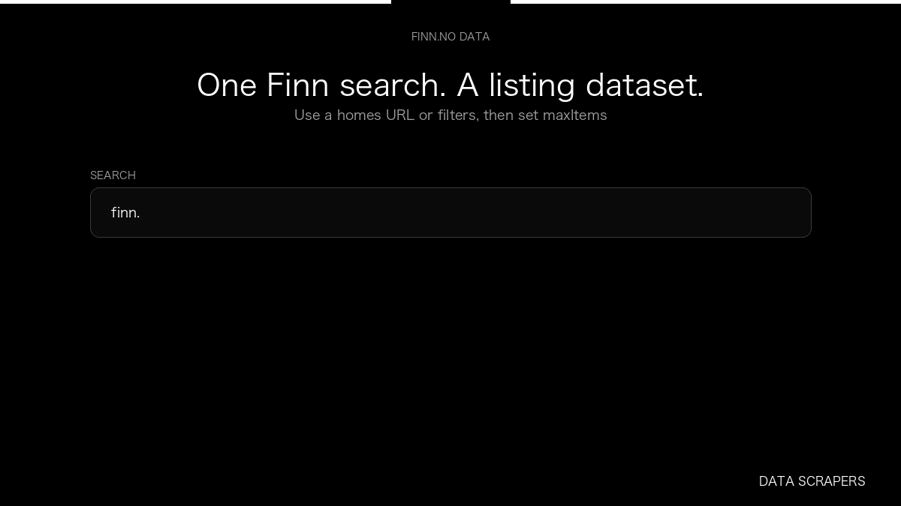

# Finn.no Real Estate Scraper

**Finn.no Real Estate Scraper** is an Apify Actor by Data Scrapers for Finn.no data.

This folder hosts the public demo GIF used on the Actor README. The scraper itself runs on Apify Store — not in this repository.

**[Finn.no Real Estate Scraper on Apify](https://apify.com/datascrapers/finn-no-scraper)**

## What this Finn.no scraper does

Collect Norwegian home listings from Finn.no, including price, area, and listing id.

Use it as a Finn.no scraper to extract structured data and export CSV, JSON, Excel, or XML from Apify.

## Start here

1. Open [Finn.no Real Estate Scraper](https://apify.com/datascrapers/finn-no-scraper) on Apify Store.
2. Paste your Finn.no URLs, queries, or other documented inputs.
3. Click **Start** and export JSON, CSV, Excel, or XML.

If you found this GitHub page while looking for a Finn.no scraper, use the Apify link above to run it.
