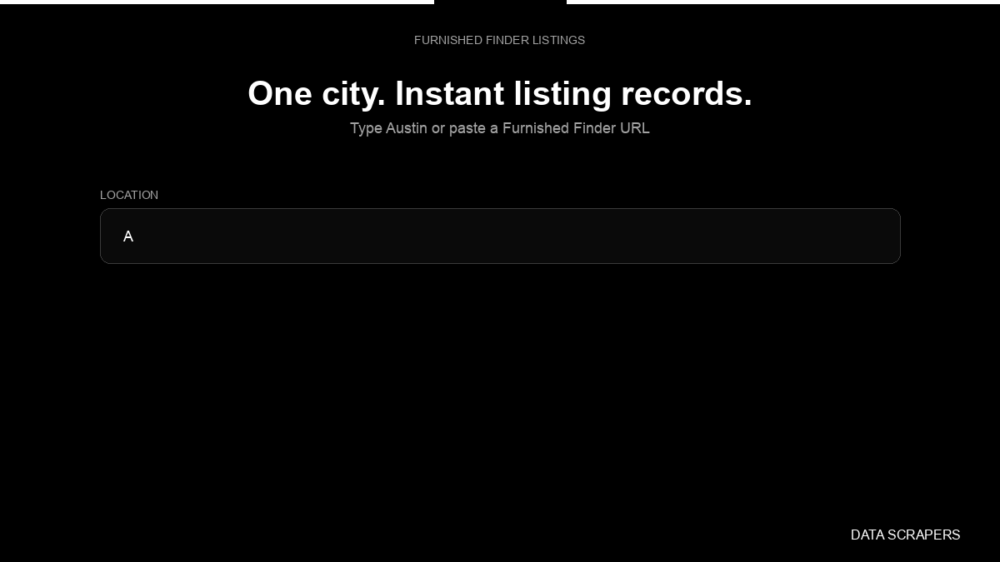

# Furnished Finder Listings and Host Contact Info

**Furnished Finder Listings and Host Contact Info** is an Apify Actor by Data Scrapers for Furnished Finder data.

This folder hosts the public demo GIF used on the Actor README. The scraper itself runs on Apify Store — not in this repository.

**[Furnished Finder Listings and Host Contact Info on Apify](https://apify.com/datascrapers/furnishedfinder-listings-and-host-contact-info)**

## What this Furnished Finder scraper does

Instant Furnished Finder listing dataset with rent, availability, linked host profiles, and host phone numbers.

Use it as a Furnished Finder scraper to extract structured data and export CSV, JSON, Excel, or XML from Apify.

## Start here

1. Open [Furnished Finder Listings and Host Contact Info](https://apify.com/datascrapers/furnishedfinder-listings-and-host-contact-info) on Apify Store.
2. Paste your Furnished Finder URLs, queries, or other documented inputs.
3. Click **Start** and export JSON, CSV, Excel, or XML.

If you found this GitHub page while looking for a Furnished Finder scraper, use the Apify link above to run it.
