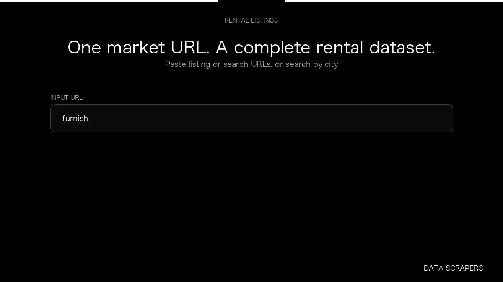

# Furnished Finder Scraper

**Furnished Finder Scraper** is an Apify Actor by Data Scrapers for Furnished Finder data.

This folder hosts the public demo GIF used on the Actor README. The scraper itself runs on Apify Store — not in this repository.

**[Furnished Finder Scraper on Apify](https://apify.com/datascrapers/furnishedfinder)**

## What this Furnished Finder scraper does

Collect furnished rental listings from Furnished Finder, including rent, availability, photos, and optional host contact fields, then export them as JSON or CSV.

Use it as a Furnished Finder scraper to extract structured data and export CSV, JSON, Excel, or XML from Apify.

## Start here

1. Open [Furnished Finder Scraper](https://apify.com/datascrapers/furnishedfinder) on Apify Store.
2. Paste your Furnished Finder URLs, queries, or other documented inputs.
3. Click **Start** and export JSON, CSV, Excel, or XML.

If you found this GitHub page while looking for a Furnished Finder scraper, use the Apify link above to run it.
