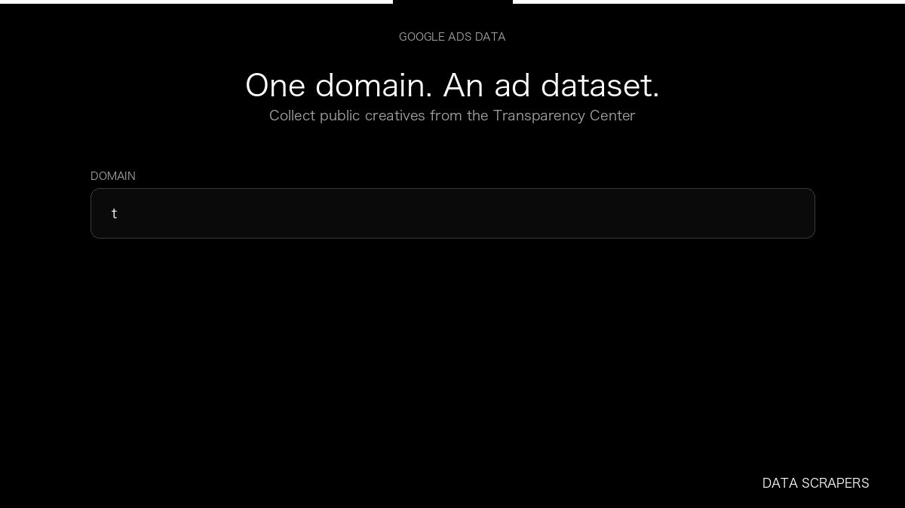

# Google Ads Transparency Scraper

**Google Ads Transparency Scraper** is an Apify Actor by Data Scrapers for Google Ads Transparency data.

This folder hosts the public demo GIF used on the Actor README. The scraper itself runs on Apify Store — not in this repository.

**[Google Ads Transparency Scraper on Apify](https://apify.com/datascrapers/google-ads-scraper)**

## What this Google Ads Transparency scraper does

Collect Google Ads Transparency creatives as a dataset, with advertiser, format, and creative id.

Use it as a Google Ads Transparency scraper to extract structured data and export CSV, JSON, Excel, or XML from Apify.

## Start here

1. Open [Google Ads Transparency Scraper](https://apify.com/datascrapers/google-ads-scraper) on Apify Store.
2. Paste your Google Ads Transparency URLs, queries, or other documented inputs.
3. Click **Start** and export JSON, CSV, Excel, or XML.

If you found this GitHub page while looking for a Google Ads Transparency scraper, use the Apify link above to run it.
