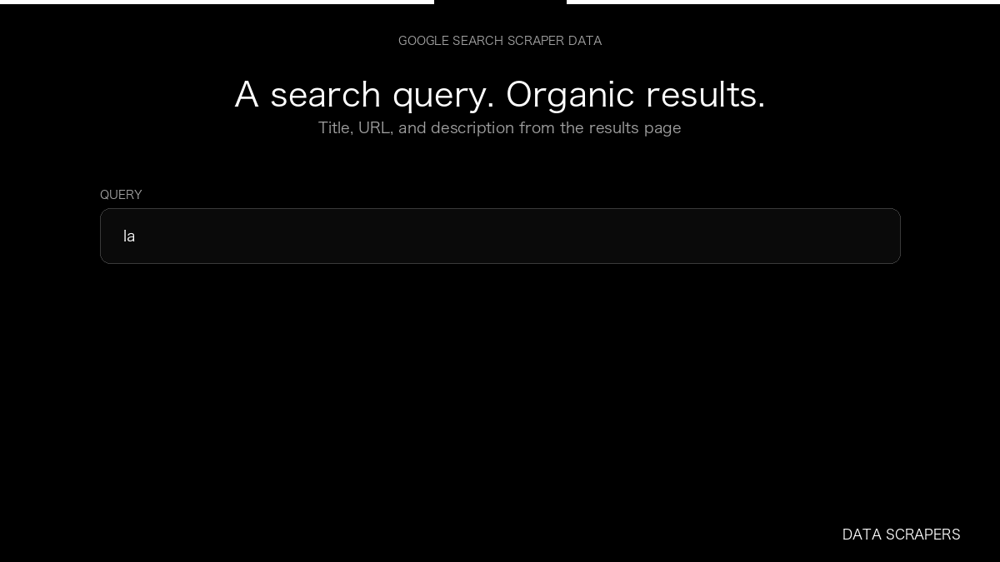

# Google Search Scraper

**Google Search Scraper** is an Apify Actor by Data Scrapers for Google Search data.

This folder hosts the public demo GIF used on the Actor README. The scraper itself runs on Apify Store — not in this repository.

**[Google Search Scraper on Apify](https://apify.com/datascrapers/google-scraper)**

## What this Google Search scraper does

Collect organic Google results with title, URL, and position.

Use it as a Google Search scraper to extract structured data and export CSV, JSON, Excel, or XML from Apify.

## Start here

1. Open [Google Search Scraper](https://apify.com/datascrapers/google-scraper) on Apify Store.
2. Paste your Google Search URLs, queries, or other documented inputs.
3. Click **Start** and export JSON, CSV, Excel, or XML.

If you found this GitHub page while looking for a Google Search scraper, use the Apify link above to run it.
