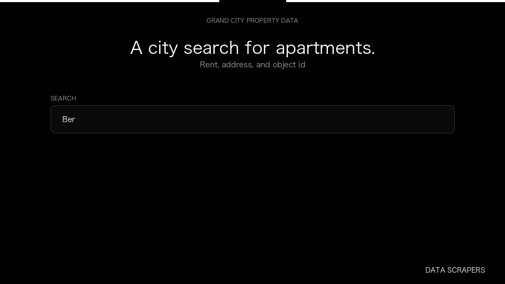

# Grand City Property

**Grand City Property** is an Apify Actor by Data Scrapers for Grand City Property data.

This folder hosts the public demo GIF used on the Actor README. The scraper itself runs on Apify Store — not in this repository.

**[Grand City Property on Apify](https://apify.com/datascrapers/grandcityproperty)**

## What this Grand City Property scraper does

Grand City Property apartments with address, city, rent, and currency.

Use it as a Grand City Property scraper to extract structured data and export CSV, JSON, Excel, or XML from Apify.

## Start here

1. Open [Grand City Property](https://apify.com/datascrapers/grandcityproperty) on Apify Store.
2. Paste your Grand City Property URLs, queries, or other documented inputs.
3. Click **Start** and export JSON, CSV, Excel, or XML.

If you found this GitHub page while looking for a Grand City Property scraper, use the Apify link above to run it.
