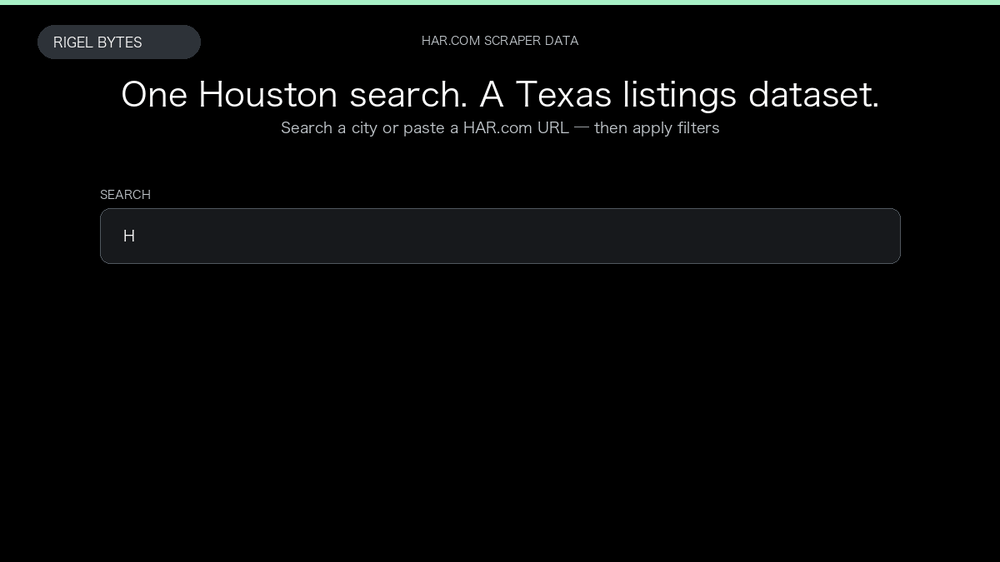

# HAR.com Scraper

**HAR.com Scraper** is an Apify Actor by Rigel Bytes for HAR.com data.

This folder hosts the public demo GIF used on the Actor README. The scraper itself runs on Apify Store — not in this repository.

**[HAR.com Scraper on Apify](https://apify.com/rigelbytes/har-com-scraper)**

## What this HAR.com scraper does

Scrape Texas real estate listings from HAR.com with price, beds, agent, and optional listing details and seller profiles on each row.

Use it as a HAR.com scraper to extract structured data and export CSV, JSON, Excel, or XML from Apify.

## Start here

1. Open [HAR.com Scraper](https://apify.com/rigelbytes/har-com-scraper) on Apify Store.
2. Paste your HAR.com URLs, queries, or other documented inputs.
3. Click **Start** and export JSON, CSV, Excel, or XML.

If you found this GitHub page while looking for a HAR.com scraper, use the Apify link above to run it.
