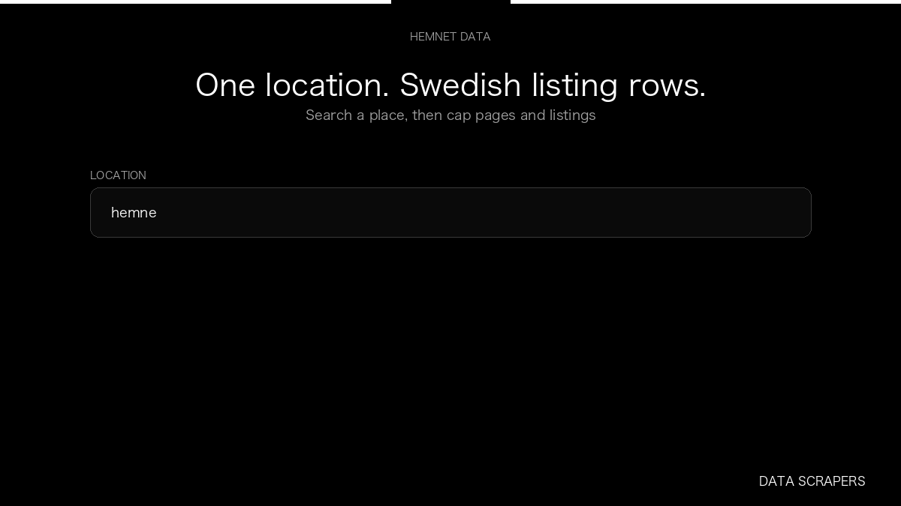

# Hemnet.se Scraper

**Hemnet.se Scraper** is an Apify Actor by Data Scrapers for Hemnet data.

This folder hosts the public demo GIF used on the Actor README. The scraper itself runs on Apify Store — not in this repository.

**[Hemnet.se Scraper on Apify](https://apify.com/datascrapers/hemnet-se-scraper)**

## What this Hemnet scraper does

Collect Swedish property listings from Hemnet, including address, asking price, and listing id.

Use it as a Hemnet scraper to extract structured data and export CSV, JSON, Excel, or XML from Apify.

## Start here

1. Open [Hemnet.se Scraper](https://apify.com/datascrapers/hemnet-se-scraper) on Apify Store.
2. Paste your Hemnet URLs, queries, or other documented inputs.
3. Click **Start** and export JSON, CSV, Excel, or XML.

If you found this GitHub page while looking for a Hemnet scraper, use the Apify link above to run it.
