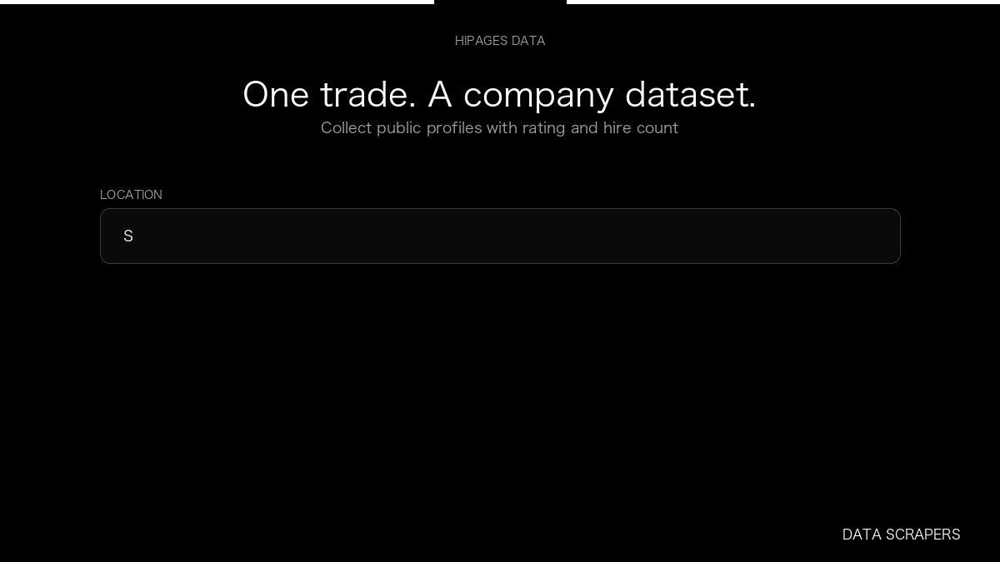

# hipages Australia Scraper

**hipages Australia Scraper** is an Apify Actor by Data Scrapers for hipages data.

This folder hosts the public demo GIF used on the Actor README. The scraper itself runs on Apify Store — not in this repository.

**[hipages Australia Scraper on Apify](https://apify.com/datascrapers/hipages-au-scraper)**

## What this hipages scraper does

Collect hipages trade businesses as a dataset, with rating, hires, and category.

Use it as a hipages scraper to extract structured data and export CSV, JSON, Excel, or XML from Apify.

## Start here

1. Open [hipages Australia Scraper](https://apify.com/datascrapers/hipages-au-scraper) on Apify Store.
2. Paste your hipages URLs, queries, or other documented inputs.
3. Click **Start** and export JSON, CSV, Excel, or XML.

If you found this GitHub page while looking for a hipages scraper, use the Apify link above to run it.
