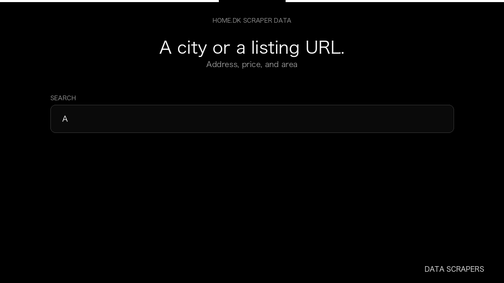

# Home.dk Scraper

**Home.dk Scraper** is an Apify Actor by Data Scrapers for home.dk data.

This folder hosts the public demo GIF used on the Actor README. The scraper itself runs on Apify Store — not in this repository.

**[Home.dk Scraper on Apify](https://apify.com/datascrapers/home-dk-scraper)**

## What this home.dk scraper does

home.dk listings with address, city, price, and floor area.

Use it as a home.dk scraper to extract structured data and export CSV, JSON, Excel, or XML from Apify.

## Start here

1. Open [Home.dk Scraper](https://apify.com/datascrapers/home-dk-scraper) on Apify Store.
2. Paste your home.dk URLs, queries, or other documented inputs.
3. Click **Start** and export JSON, CSV, Excel, or XML.

If you found this GitHub page while looking for a home.dk scraper, use the Apify link above to run it.
