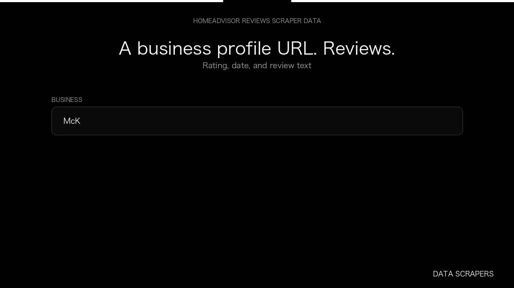

# HomeAdvisor Reviews Scraper

**HomeAdvisor Reviews Scraper** is an Apify Actor by Data Scrapers for HomeAdvisor data.

This folder hosts the public demo GIF used on the Actor README. The scraper itself runs on Apify Store — not in this repository.

**[HomeAdvisor Reviews Scraper on Apify](https://apify.com/datascrapers/homeadvisor-reviews-scraper)**

## What this HomeAdvisor scraper does

Collect customer reviews from HomeAdvisor business profiles.

Use it as a HomeAdvisor scraper to extract structured data and export CSV, JSON, Excel, or XML from Apify.

## Start here

1. Open [HomeAdvisor Reviews Scraper](https://apify.com/datascrapers/homeadvisor-reviews-scraper) on Apify Store.
2. Paste your HomeAdvisor URLs, queries, or other documented inputs.
3. Click **Start** and export JSON, CSV, Excel, or XML.

If you found this GitHub page while looking for a HomeAdvisor scraper, use the Apify link above to run it.
