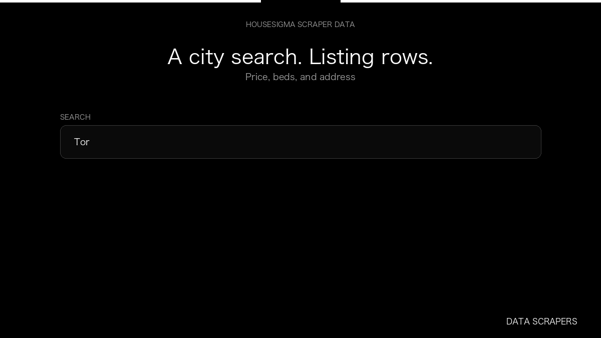

# HouseSigma Scraper

**HouseSigma Scraper** is an Apify Actor by Data Scrapers for HouseSigma data.

This folder hosts the public demo GIF used on the Actor README. The scraper itself runs on Apify Store — not in this repository.

**[HouseSigma Scraper on Apify](https://apify.com/datascrapers/housesigma-scraper)**

## What this HouseSigma scraper does

HouseSigma listings with address, price, bedrooms, and house type.

Use it as a HouseSigma scraper to extract structured data and export CSV, JSON, Excel, or XML from Apify.

## Start here

1. Open [HouseSigma Scraper](https://apify.com/datascrapers/housesigma-scraper) on Apify Store.
2. Paste your HouseSigma URLs, queries, or other documented inputs.
3. Click **Start** and export JSON, CSV, Excel, or XML.

If you found this GitHub page while looking for a HouseSigma scraper, use the Apify link above to run it.
