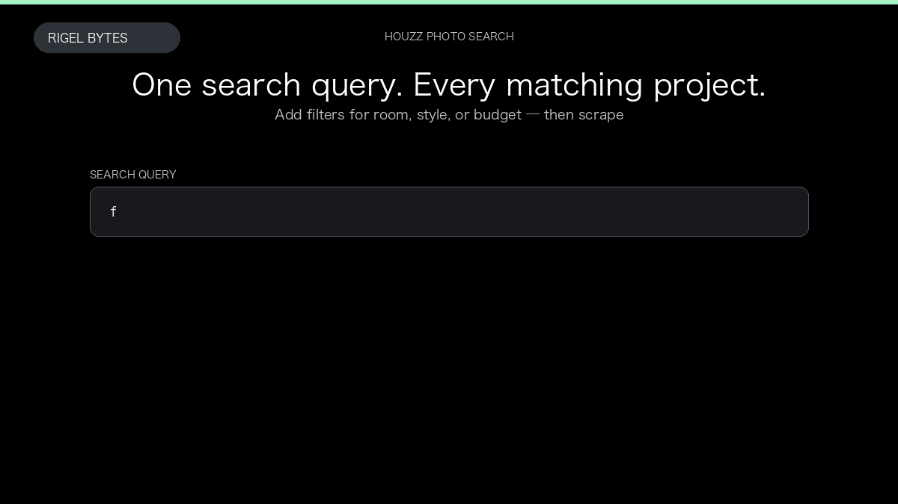

# Houzz Projects Scraper

**Houzz Projects Scraper** is an Apify Actor by Rigel Bytes for Houzz data.

This folder hosts the public demo GIF used on the Actor README. The scraper itself runs on Apify Store — not in this repository.

**[Houzz Projects Scraper on Apify](https://apify.com/rigelbytes/houzz-scraper)**

## What this Houzz scraper does

Scrape Houzz photo projects with designer profiles, services, and reviews in one dataset row per project.

Use it as a Houzz scraper to extract structured data and export CSV, JSON, Excel, or XML from Apify.

## Start here

1. Open [Houzz Projects Scraper](https://apify.com/rigelbytes/houzz-scraper) on Apify Store.
2. Paste your Houzz URLs, queries, or other documented inputs.
3. Click **Start** and export JSON, CSV, Excel, or XML.

If you found this GitHub page while looking for a Houzz scraper, use the Apify link above to run it.
