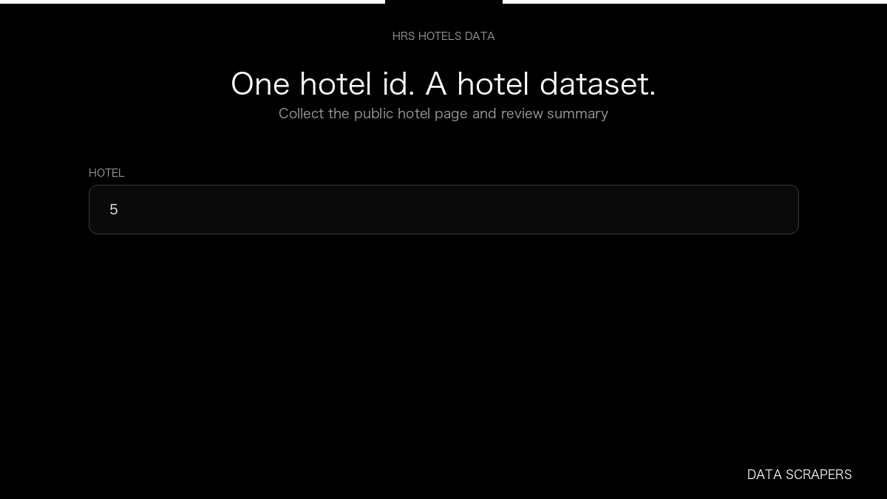

# HRS Hotel Reviews Scraper

**HRS Hotel Reviews Scraper** is an Apify Actor by Data Scrapers for HRS data.

This folder hosts the public demo GIF used on the Actor README. The scraper itself runs on Apify Store — not in this repository.

**[HRS Hotel Reviews Scraper on Apify](https://apify.com/datascrapers/hrs-hotel-reviews-scraper)**

## What this HRS scraper does

Collect HRS hotels as a dataset, with stars, city, and review summary.

Use it as a HRS scraper to extract structured data and export CSV, JSON, Excel, or XML from Apify.

## Start here

1. Open [HRS Hotel Reviews Scraper](https://apify.com/datascrapers/hrs-hotel-reviews-scraper) on Apify Store.
2. Paste your HRS URLs, queries, or other documented inputs.
3. Click **Start** and export JSON, CSV, Excel, or XML.

If you found this GitHub page while looking for a HRS scraper, use the Apify link above to run it.
