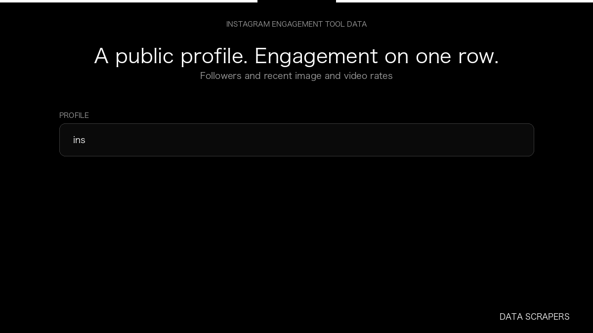

# Instagram Engagement Tool

**Instagram Engagement Tool** is an Apify Actor by Data Scrapers for Instagram data.

This folder hosts the public demo GIF used on the Actor README. The scraper itself runs on Apify Store — not in this repository.

**[Instagram Engagement Tool on Apify](https://apify.com/datascrapers/instagram-engagement-tool)**

## What this Instagram scraper does

Measure public Instagram profile engagement from recent image and video posts.

Use it as a Instagram scraper to extract structured data and export CSV, JSON, Excel, or XML from Apify.

## Start here

1. Open [Instagram Engagement Tool](https://apify.com/datascrapers/instagram-engagement-tool) on Apify Store.
2. Paste your Instagram URLs, queries, or other documented inputs.
3. Click **Start** and export JSON, CSV, Excel, or XML.

If you found this GitHub page while looking for a Instagram scraper, use the Apify link above to run it.
