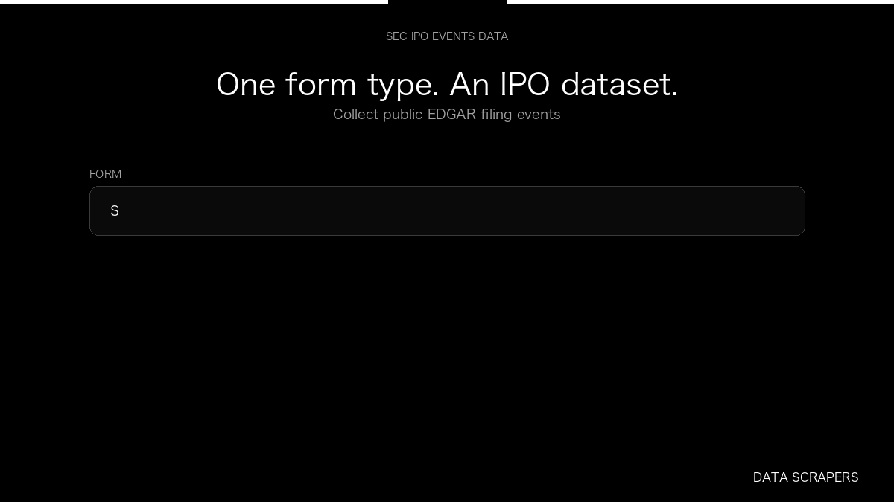

# SEC IPO Event Intelligence

**SEC IPO Event Intelligence** is an Apify Actor by Data Scrapers for SEC EDGAR data.

This folder hosts the public demo GIF used on the Actor README. The scraper itself runs on Apify Store — not in this repository.

**[SEC IPO Event Intelligence on Apify](https://apify.com/datascrapers/ipo-events-api)**

## What this SEC EDGAR scraper does

Collect SEC IPO filing events as a dataset, with company, form, and date.

Use it as a SEC EDGAR scraper to extract structured data and export CSV, JSON, Excel, or XML from Apify.

## Start here

1. Open [SEC IPO Event Intelligence](https://apify.com/datascrapers/ipo-events-api) on Apify Store.
2. Paste your SEC EDGAR URLs, queries, or other documented inputs.
3. Click **Start** and export JSON, CSV, Excel, or XML.

If you found this GitHub page while looking for a SEC EDGAR scraper, use the Apify link above to run it.
