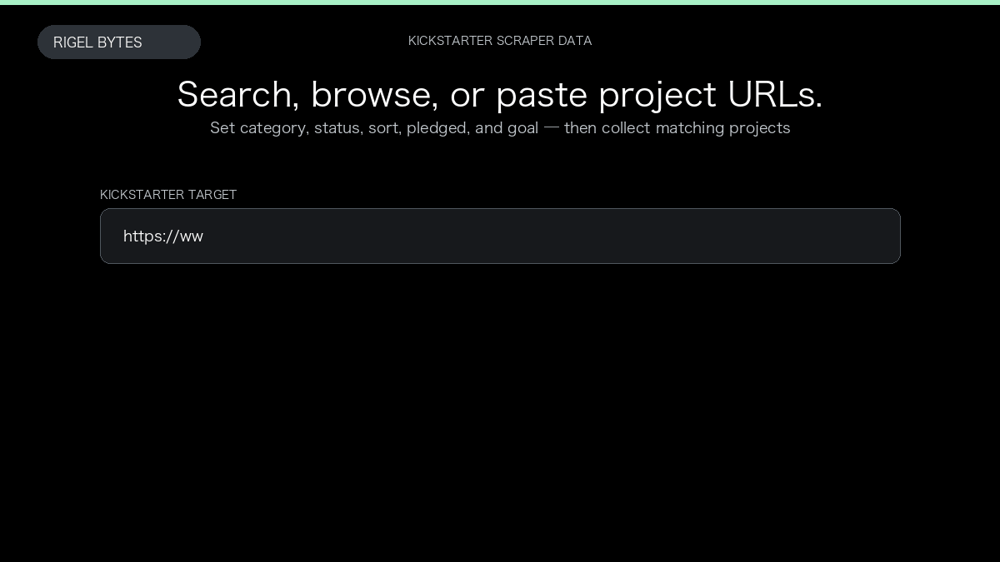

# Kickstarter Scraper

**Kickstarter Scraper** is an Apify Actor by Rigel Bytes for Kickstarter data.

This folder hosts the public demo GIF used on the Actor README. The scraper itself runs on Apify Store — not in this repository.

**[Kickstarter Scraper on Apify](https://apify.com/rigelbytes/kickstarter-scraper)**

## What this Kickstarter scraper does

Extract Kickstarter projects from search, category, and discover URLs. Each row includes listing metrics plus optional project details and comment threads, with pay-per-event billing.

Use it as a Kickstarter scraper to extract structured data and export CSV, JSON, Excel, or XML from Apify.

## Start here

1. Open [Kickstarter Scraper](https://apify.com/rigelbytes/kickstarter-scraper) on Apify Store.
2. Paste your Kickstarter URLs, queries, or other documented inputs.
3. Click **Start** and export JSON, CSV, Excel, or XML.

If you found this GitHub page while looking for a Kickstarter scraper, use the Apify link above to run it.
