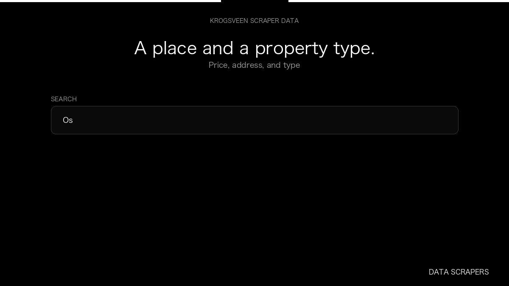

# Krogsveen Scraper

**Krogsveen Scraper** is an Apify Actor by Data Scrapers for Krogsveen data.

This folder hosts the public demo GIF used on the Actor README. The scraper itself runs on Apify Store — not in this repository.

**[Krogsveen Scraper on Apify](https://apify.com/datascrapers/krogsveen-no-scraper)**

## What this Krogsveen scraper does

Krogsveen listings with address, area, suggested price, and property type.

Use it as a Krogsveen scraper to extract structured data and export CSV, JSON, Excel, or XML from Apify.

## Start here

1. Open [Krogsveen Scraper](https://apify.com/datascrapers/krogsveen-no-scraper) on Apify Store.
2. Paste your Krogsveen URLs, queries, or other documented inputs.
3. Click **Start** and export JSON, CSV, Excel, or XML.

If you found this GitHub page while looking for a Krogsveen scraper, use the Apify link above to run it.
